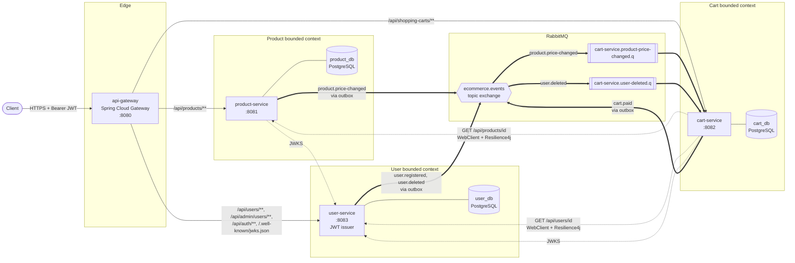

# Architecture — Ecommerce Microservices

Container-level view (C4 level 2) of how the services, their databases and the
message broker connect. For the table-level data model see [MER.md](MER.md).

## Container Diagram



Legend: solid arrows are inbound HTTP traffic, dotted arrows are synchronous
service-to-service HTTP calls, and thick arrows are asynchronous messaging.

## Databases

Each service owns its database and no service reads another service's tables.
Cross-service references (for example `shopping_cart.user_id` or
`products_shopping_cart.product_id`) are **logical references by ID**, not
database foreign keys. They are resolved over HTTP or kept in sync with events.

| Database | Owner | Docker container | Host port |
|---|---|---|---|
| `product_db` | product-service | `product-db` | 5433 |
| `cart_db` | cart-service | `cart-db` | 5434 |
| `user_db` | user-service | `user-db` | 5435 |

Every database also holds an `outbox_message` table that the transactional
outbox uses (see below). In development, each service uses H2 in-memory instead.

## Synchronous Communication

| Caller | Callee | Endpoint | Purpose | Resilience |
|---|---|---|---|---|
| api-gateway | all services | path-based routes | Single entry point. Rejects requests missing `Authorization` | — |
| cart-service | product-service | `GET /api/products/{id}` | Read product data and price when adding items | Circuit breaker `product-service`, retry, timeouts |
| cart-service | user-service | `GET /api/users/{id}` | Validate the cart owner | Circuit breaker `user-service`, retry, timeouts |
| product-service, cart-service | user-service | `GET /.well-known/jwks.json` | Fetch the public key to verify RS256 JWTs locally | — |

## Asynchronous Communication

### Transactional Outbox

Application code never publishes to RabbitMQ directly. In the same database
transaction as the business change, the service writes the event to its
`outbox_message` table. `OutboxPublisherJob` (from `buildingblocks`) polls that
table every 5 seconds and publishes pending messages to the
`ecommerce.events` exchange, using the event type as the routing key.

```mermaid
sequenceDiagram
    participant S as Service (application layer)
    participant DB as Service DB
    participant J as OutboxPublisherJob
    participant X as ecommerce.events
    participant C as OutboxRabbitCallbacks

    S->>DB: BEGIN; update aggregate; INSERT outbox_message; COMMIT
    loop every 5s
        J->>DB: BEGIN; claim eligible rows (row lock, next_attempt_at = now + 60s lease); COMMIT
        J->>X: publish(routingKey = event_type, payload, correlationId)
        Note over J,C: send exception → C.recordFailure for that row only
    end
    X-->>C: confirm ACK, message not returned → status = PUBLISHED
    X-->>C: confirm ACK, message returned (unroutable) → failure
    X-->>C: NACK → failure
    Note over C,DB: failure = retry_count++, next_attempt_at = now + backoff (5s doubling, capped at 300s)
    Note over C,DB: retry_count reaches OutboxRetryPolicy.MAX_ATTEMPTS (8) → status = DEAD_LETTER + ERROR log
```

The claim is committed before anything is sent, so a row awaiting its confirm
stays invisible to every poller until the 60-second lease expires. If the
confirm never arrives, the row becomes eligible again and is re-sent
(at-least-once delivery), so consumers must be idempotent. `OutboxRetryPolicy`
is the single source for `MAX_ATTEMPTS`, the backoff and the lease.

### Topology

`buildingblocks` declares the single durable topic exchange `ecommerce.events`.
Each consuming service declares its own durable queues and bindings next to its
`@RabbitListener`.

### Event Catalog

| Routing key | Contract (`buildingblocks.contracts`) | Producer | Consumers | Consumer queue |
|---|---|---|---|---|
| `product.price-changed` | `ProductPriceChanged` | product-service | cart-service: updates line-item prices with an optimistic-lock retry | `cart-service.product-price-changed.q` |
| `user.deleted` | `UserDeleted` | user-service | cart-service: currently only logs (minimal handling) | `cart-service.user-deleted.q` |
| `user.registered` | `UserRegistered` | user-service | _none yet_ | — |
| `cart.paid` | `CartPaid` | cart-service | _none yet_ | — |

Events without a bound queue are unroutable: the broker returns them to the
publisher (`publisher-returns: true`) and still acks them. The outbox treats an
acked-but-returned message as a failure, never as PUBLISHED, so it is retried
with backoff and moved to `DEAD_LETTER` after `OutboxRetryPolicy.MAX_ATTEMPTS`
attempts, with an ERROR log. `user.registered` and `cart.paid` will therefore
dead-letter until a consumer declares a binding.

## Authentication Flow

`user-service` is the only JWT issuer (RS256). It signs tokens with the private
key that Docker mounts as the `jwt_private_key` secret, and exposes the public
key at `/.well-known/jwks.json`. The gateway only checks that the
`Authorization` header is present and forwards it. Each service verifies the
token independently with the shared `buildingblocks` filter (defense in depth).
