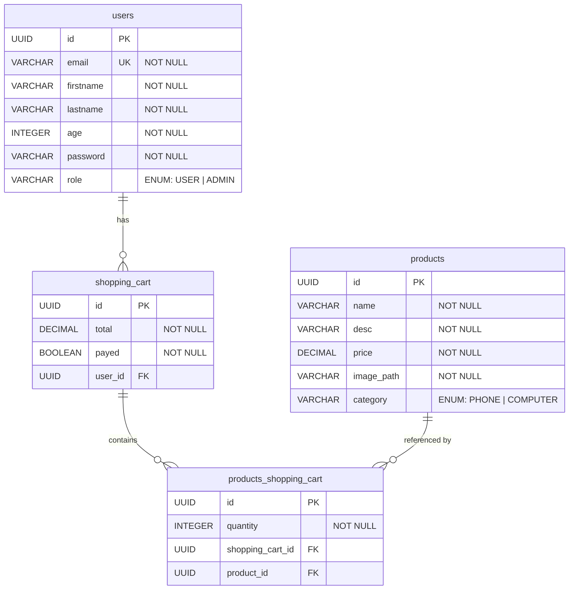

# Entity-Relationship Model — Ecommerce API

## Diagram

## Tables

### `users`
| Column | Type | Constraints |
|--------|------|-------------|
| `id` | UUID | PK, generated |
| `email` | VARCHAR | UNIQUE, NOT NULL |
| `firstname` | VARCHAR | NOT NULL |
| `lastname` | VARCHAR | NOT NULL |
| `age` | INTEGER | NOT NULL |
| `password` | VARCHAR | NOT NULL |
| `role` | VARCHAR | NOT NULL, ENUM(`USER`, `ADMIN`) |

### `shopping_cart`
| Column | Type | Constraints |
|--------|------|-------------|
| `id` | UUID | PK, generated |
| `total` | DECIMAL | NOT NULL |
| `payed` | BOOLEAN | NOT NULL |
| `user_id` | UUID | FK → `users.id`, NOT NULL |

### `products`
| Column | Type | Constraints |
|--------|------|-------------|
| `id` | UUID | PK, generated |
| `name` | VARCHAR | NOT NULL |
| `desc` | VARCHAR | NOT NULL |
| `price` | DECIMAL | NOT NULL |
| `image_path` | VARCHAR | NOT NULL |
| `category` | VARCHAR | NOT NULL, ENUM(`PHONE`, `COMPUTER`) |

### `products_shopping_cart`
| Column | Type | Constraints |
|--------|------|-------------|
| `id` | UUID | PK, generated |
| `quantity` | INTEGER | NOT NULL |
| `shopping_cart_id` | UUID | FK → `shopping_cart.id`, NOT NULL |
| `product_id` | UUID | FK → `products.id`, NOT NULL |

## Relationships

| Relationship | Cardinality | Description |
|---|---|---|
| `users` → `shopping_cart` | One-to-Many | A user can have multiple shopping carts |
| `shopping_cart` → `products_shopping_cart` | One-to-Many | A cart contains multiple line items |
| `products` → `products_shopping_cart` | One-to-Many | A product can appear in multiple carts |

> `products_shopping_cart` is a join table between `shopping_cart` and `products`, adding `quantity` as an extra attribute.
